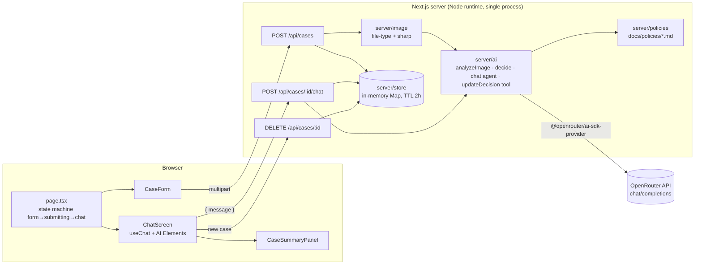
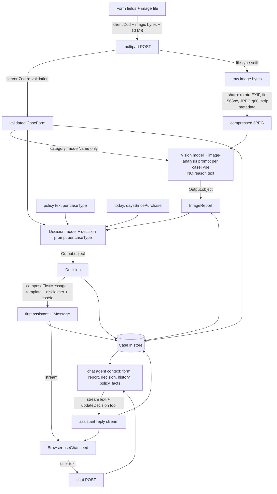
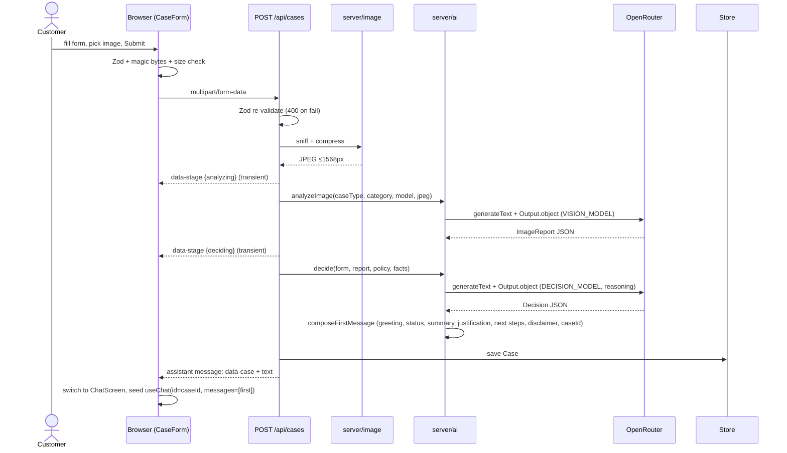
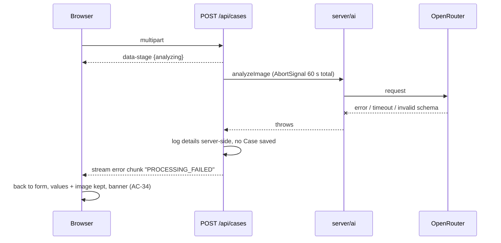
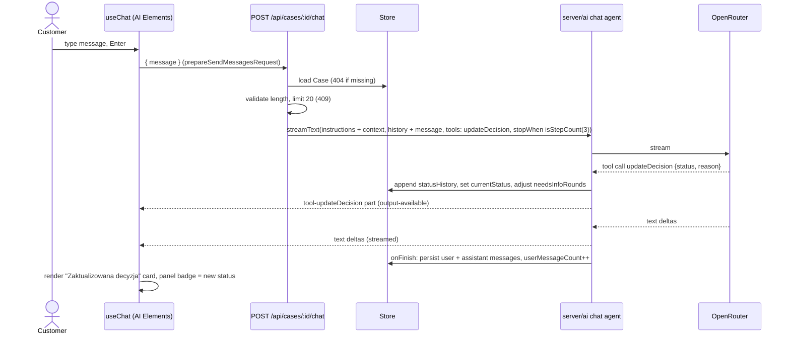
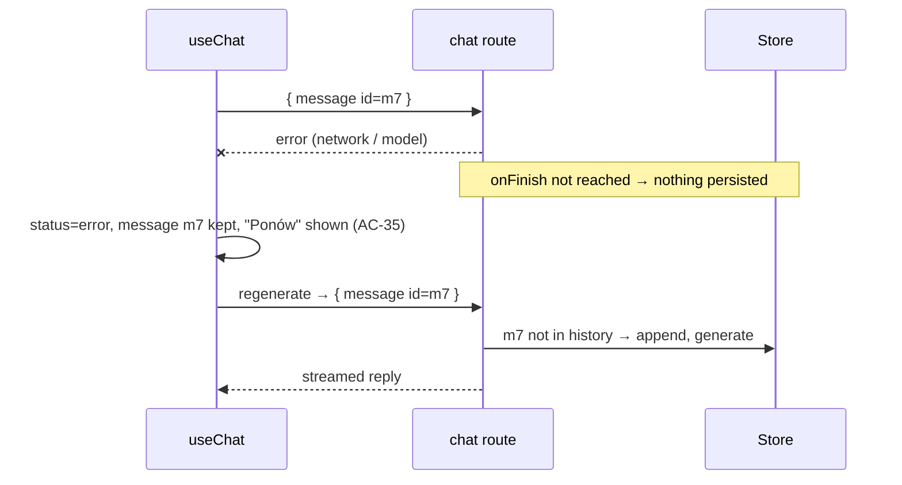
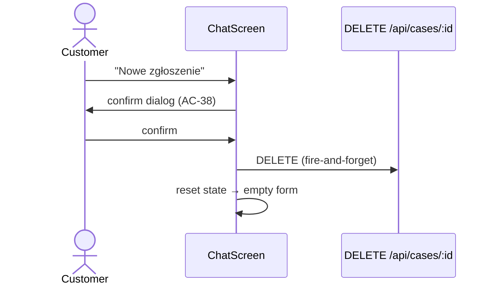

# ADR: Hardware Service Decision Copilot — Main Architecture

**Date:** 2026-10-18
**Status:** Accepted
**PRD:** [`docs/PRD.md`](../PRD.md)

---

## 1. Overview

The MVP is a customer self-service web application. The customer submits a return or complaint form with one photo. A multimodal LLM describes the device's condition, and a reasoning LLM issues a preliminary decision based on the store terms (`docs/policies/*.md`). The customer then continues in a streaming chat with the same agent, which can revise the decision.

This ADR set defines the stack, module layout, contracts, data models and test strategy. The PRD defines *what* to build; these ADRs define *how*.

| File | Area |
|---|---|
| `000-main-architecture.md` | System overview, stack, option evaluation, cross-cutting decisions |
| `001-project-setup.md` | Initializing the empty `app/` folder, tooling, strict TypeScript, test runners |
| `002-backend-api.md` | Route handlers, in-memory case store, validation, image processing, error handling |
| `003-ai-pipeline.md` | OpenRouter provider, models, prompts, structured outputs, chat agent, tools |
| `004-frontend-ui.md` | Screens, AI Elements chat, form, client state machine, styling |

Research was done on 2026-10-18 against current docs (Context7 + official sites). Versions below are the latest published on npm on that date.

---

## 2. Technology Documentation References

| Library | Context7 ID or official docs | Used for |
|---|---|---|
| Vercel AI SDK (`ai` 7.x, `@ai-sdk/react` 4.x) | `/vercel/ai` | `generateText` + `Output.object`, `streamText`, tools, `createUIMessageStream`, `readUIMessageStream`, `useChat`, `MockLanguageModelV4` |
| OpenRouter AI SDK provider (`@openrouter/ai-sdk-provider` 3.x) | `/openrouterteam/ai-sdk-provider` | Model access through OpenRouter |
| OpenRouter platform docs | `/websites/openrouter_ai` · https://openrouter.ai/docs | Image input formats, model capabilities, reasoning options |
| Next.js 16 (App Router) | `/vercel/next.js` | Framework, route handlers, `create-next-app` |
| AI Elements | `/vercel/ai-elements` | Chat UI components (Conversation, Message, MessageResponse, PromptInput) |
| assistant-ui (evaluated, not chosen) | `/assistant-ui/assistant-ui` | Comparison only |
| Chat SDK (evaluated, not chosen) | https://chat-sdk.dev/ | Comparison only |
| OpenRouter Responses API (evaluated, not chosen) | https://openrouter.ai/docs/api_reference/responses/overview | Comparison only |
| Zod 4 | https://zod.dev | Shared validation schemas and LLM output schemas |
| sharp | https://sharp.pixelplumbing.com | Server-side image normalization and compression |
| file-type | https://github.com/sindresorhus/file-type | Magic-byte image detection (client and server) |
| Vitest | https://vitest.dev | Unit and integration tests |
| Playwright | https://playwright.dev | E2E tests and manual QA (Playwright CLI) |

---

## 3. System Architecture

### Architecture pattern
A single-process Next.js App Router monolith. The React client renders one page. Server route handlers under `/api` run on the Node.js runtime, call OpenRouter through the AI SDK and keep cases in a process-local in-memory store. There is no database and no separate backend service.

### Repository structure
```
/                         repo root (course scaffold; unchanged)
├── app/                  Next.js application (this ADR set) — own package.json
│   ├── src/app/          routes: page.tsx (single screen), api/** route handlers
│   ├── src/components/   ui/ (shadcn), ai-elements/ (AI Elements, generated), case/ (feature components)
│   ├── src/lib/          shared isomorphic code: schemas, enums, Polish strings, case-id format
│   ├── src/server/       server-only code: case store, image processing, AI pipeline, prompts, policy loader
│   ├── tests/            unit/, integration/, e2e/, fixtures/
│   └── AGENTS.md         stack-specific agent rules (generated by create-next-app, then extended)
├── docs/                 PRD, ADR, policies (source of truth for terms), design guidelines
└── assets/               brand tokens, logo, example images (E2E inputs)
```
Code in `src/server/` must never be imported by client components. The `server-only` package marker enforces this at build time.

### Technology stack

| Layer | Technology | Reason |
|---|---|---|
| Runtime | Node.js 24 LTS (installed: v24.20.0) | Meets the Next.js ≥ 20.9 requirement. Native `fetch`, `AbortSignal.timeout` and `crypto`. |
| Framework | Next.js 16.4 App Router, TypeScript strict | Required by brief. One codebase for UI and route handlers, with native streaming responses. |
| Frontend | React 19, Tailwind CSS 4, shadcn/ui, AI Elements | AI Elements renders `useChat` message parts (including streamed markdown) out of the box, and its components are copied into the repo so we can restyle them. |
| AI SDK | `ai` 7.x + `@ai-sdk/react` 4.x | Unified API for structured output, streaming, tools and the UI message protocol. |
| LLM access | `@openrouter/ai-sdk-provider` 3.x → OpenRouter Chat Completions | Uses `OPENROUTER_API_KEY` / `LLM_MODEL` from `.env.example`. Supports image input, reasoning and structured outputs. Peer deps: `ai ^7`, `zod ^4`. |
| Default model | `openai/gpt-6-luna` (via `LLM_MODEL`) | According to the OpenRouter models API (2026-10-18), it accepts `image` input and supports `reasoning`, `structured_outputs` and `tools`, with a 1.05M-token context. |
| Validation | Zod 4 | One schema drives client form validation, server re-validation and LLM output schemas. |
| Image processing | sharp 0.35 | EXIF-aware rotation, resizing and JPEG re-encoding. Handles every sample image format. |
| File sniffing | file-type 22 | Detects JPEG/PNG/WebP by content (AC-08). `laptop-1.png` is really a JPEG. |
| State | In-memory `Map` in the server process | User decision. No persistence in the MVP (PRD §7). |
| Tests | Vitest + Testing Library, Playwright | Matches the repo test strategy (AGENTS.md). |
| Package manager | npm 11 | Already installed. User decision. |
| Deployment | Local only (`next dev` / `next build && next start`) | User decision. A single process is required by the in-memory store. |

---

## 4. Module Structure & Dependencies

| Module | Responsibility | Depends on | Used by |
|---|---|---|---|
| `lib/domain` | Enums (case type, category, decision status with Polish labels), case ID format, limits (10 MB, 2000 chars, 20 messages, 60 s) | – | everything |
| `lib/schemas` | Zod schemas: case form, chat request, image reports, decision, `updateDecision` tool input, typed `HscUIMessage` | `lib/domain`, zod, `ai` (types only) | client form, route handlers, AI pipeline |
| `lib/i18n/pl` | All Polish UI strings and error messages | `lib/domain` | client, server error mapping |
| `server/policies` | Loads `docs/policies/*.md` once at first use and caches them | Node `fs` | `server/ai` |
| `server/image` | Validates magic bytes and normalizes and compresses the image | sharp, file-type | `api/cases` route |
| `server/ai` | Model factory (OpenRouter), prompts, `analyzeImage`, `decide`, `composeFirstMessage`, `createChatStream`, `updateDecision` tool | `lib/*`, `server/policies`, `ai`, provider | route handlers |
| `server/store` | In-memory case store with TTL, size cap and ID generation | `lib/domain` | route handlers, `server/ai` (tool execute) |
| `app/api/cases` | POST: create a case (multipart → stream) | `server/image`, `server/ai`, `server/store`, `lib/schemas` | client |
| `app/api/cases/[caseId]/chat` | POST: chat turn (stream) | `server/ai`, `server/store`, `lib/schemas` | client (`useChat`) |
| `app/api/cases/[caseId]` | DELETE: discard a case | `server/store` | client |
| `components/case` | CaseForm, ProcessingIndicator, ChatScreen, CaseSummaryPanel, DecisionBadge, DecisionUpdateCard, NewCaseDialog | `lib/*`, `components/ui`, `components/ai-elements`, `@ai-sdk/react` | `app/page.tsx` |

Dependency direction: `app/api/*` → `server/*` → `lib/*`, and `app/page.tsx` → `components/*` → `lib/*`. `lib/*` imports nothing from `server/*` or `components/*`. No circular dependencies.

---

## 5. Data Models

All models are conceptual. Zod schemas in `lib/schemas` are the single source of truth.

| Model | Key fields | Persistence |
|---|---|---|
| **CaseForm** | `caseType` (`RETURN` \| `COMPLAINT`), `category` (9 enum values, AC-02), `modelName` (1–100 chars), `purchaseDate` (ISO date, ≤ today in Europe/Warsaw), `reason` (≤2000; ≥20 when COMPLAINT) | In Case |
| **ImageReport** (discriminated by `caseType`) | Common: `imageUsable` (bool), `imageIssue` (string \| null), `categoryMatch` (`yes`/`no`/`uncertain`), `observedDevice` (string), `visibleDamage[]` (`type`, `location`, `extent`). RETURN: `signsOfUse[]`, `visibleCompleteness`, `resaleCondition` (`as_new`/`signs_of_use`/`damaged`). COMPLAINT: `likelyCause` (`manufacturing_defect`/`normal_wear`/`mechanical_impact`/`liquid`/`unknown`), `causeConfidence` (`low`/`medium`/`high`) | In Case |
| **Decision** | `status` (`ACCEPTED`/`REJECTED`/`MANUAL_REVIEW`/`NEEDS_INFO`), `summary` (1–3 sentences), `photoFindings`, `appliedRules[]` (`ref` like "§2 ust. 3", `explanation`), `nextSteps[]` (≥1), `questions[]` (≤3, only for NEEDS_INFO) | In Case |
| **DecisionUpdate** (`updateDecision` tool input) | `status` (one of 4), `reason` (string), `appliedRules[]` | Appended to Case.statusHistory |
| **Case** | `id` (`HSC-YYYYMMDD-XXXX`), `createdAt`, `lastActivityAt`, `form`, `imageReport`, `initialDecision`, `currentStatus`, `statusHistory[]`, `needsInfoRounds` (int), `userMessageCount` (int), `messages` (HscUIMessage[]) | In-memory `Map`. Sliding 2 h TTL. Deleted on DELETE, expiry or process restart. The compressed image is **not** kept after analysis. |
| **HscUIMessage** | AI SDK `UIMessage` typed with: metadata `{ createdAt }`, data parts `case` `{ caseId, status, form summary }` and transient `stage` `{ stage: 'analyzing' \| 'deciding' }`, tools `{ updateDecision }` | Client (`useChat` state) and Case.messages |

Status → Polish label mapping (PRD AC-16) is defined once in `lib/domain`: ACCEPTED → "Przyjęte", REJECTED → "Odrzucone", MANUAL_REVIEW → "Do weryfikacji przez specjalistę", NEEDS_INFO → "Potrzebne dodatkowe informacje".

---

## 6. API / Interface Contracts

Details, status codes and error payloads are in `002-backend-api.md`.

| Endpoint | Input | Output | Notes |
|---|---|---|---|
| `POST /api/cases` | `multipart/form-data`: CaseForm fields + `image` (one file, ≤10 MB, JPEG/PNG/WebP by content) | **400** JSON `{ error: 'VALIDATION', fields: { name: code } }` before streaming. Otherwise **200** UI message stream: transient `data-stage` parts → assistant message with `data-case` part + markdown `text` part. An in-stream error chunk on failure. | Node runtime. 60 s pipeline timeout. Creates a Case only on success. |
| `POST /api/cases/{caseId}/chat` | JSON `{ message: HscUIMessage }` (last user message only, sent via `prepareSendMessagesRequest`) | **200** UI message stream: text parts + optional `tool-updateDecision` part. **404** `CASE_NOT_FOUND`, **409** `MESSAGE_LIMIT`, **400** `VALIDATION`. | The server holds the history. Idempotent on message `id` (retry). |
| `DELETE /api/cases/{caseId}` | – | **204** (also when the case doesn't exist) | Called on "Nowe zgłoszenie". |

---

## 7. Environment Variables

| Variable | Purpose | Required | Example value |
|---|---|---|---|
| `OPENROUTER_API_KEY` | OpenRouter auth (server only) | Yes | `sk-or-v1-…` |
| `LLM_MODEL` | Default OpenRouter model ID for all LLM steps | Yes | `openai/gpt-6-luna` |
| `VISION_MODEL` | Override for image analysis. Must support image input. | No (falls back to `LLM_MODEL`) | `google/gemini-3.8-flash` |
| `DECISION_MODEL` | Override for decision + chat. Must support reasoning, structured outputs and tools. | No (falls back to `LLM_MODEL`) | `anthropic/claude-sonnet-5.5` |
| `POLICIES_DIR` | Directory containing `return-policy.md` and `complaint-policy.md` | No (default `../docs/policies` relative to `app/`) | `../docs/policies` |
| `CASE_TTL_MINUTES` | Idle expiry of in-memory cases | No (default `120`) | `120` |

Env is validated with Zod at server start (first import of `server/env`). A missing required var fails fast with a readable message. `app/.env.example` mirrors this table, and the root `.env.example` stays as-is.

---

## 8. Technical Decisions

### D1 — Next.js App Router monolith with route handlers
**Status:** Accepted · **Date:** 2026-10-18
**Context:** The brief requires Next.js App Router + TypeScript strict. The app needs a form, a streaming chat and server-side LLM calls with a secret key.
**Decision:** One Next.js app in `app/`. The UI is a single client-rendered page. The server logic lives in route handlers on the Node.js runtime (the default with `cacheComponents`, required by sharp; the `runtime` export is not allowed in that mode). Server Actions are not used for the LLM flows because route handlers are the documented integration point for `useChat` and stream responses.
**Rejected alternatives:**
- Separate Express API + Vite SPA: two processes and CORS for no MVP benefit.
- Server Actions for submission: `useChat` and the UI message stream protocol expect an HTTP endpoint, and the Server Action body limit (1 MB by default) conflicts with 10 MB uploads.
**Consequences:** (+) one deployable unit and shared Zod schemas. (–) Server and client code share a repo, so the `server-only` boundary must be enforced.
**Review trigger:** A separate mobile client or third-party API consumers are added.

### D2 — Vercel AI SDK 7 + OpenRouter provider (Chat Completions), not the OpenRouter Responses API directly
**Status:** Accepted · **Date:** 2026-10-18
**Context:** We need image input, structured output, reasoning, tool calling and token streaming to a React chat, and the brief requires OpenRouter (`OPENROUTER_API_KEY`, `LLM_MODEL`). The user asked to compare the AI SDK + OpenRouter provider against the OpenRouter Responses API.
**Decision:** Use `ai` 7 with `@openrouter/ai-sdk-provider` 3 (`createOpenRouter({ apiKey })`). The provider talks to OpenRouter's Chat Completions endpoint, converts AI SDK image file parts to `image_url` parts, and passes reasoning settings via `providerOptions.openrouter`.
**Evaluation of options (links read on 2026-10-18):**

| Option | What it is (per its docs) | Fit for this PRD |
|---|---|---|
| **AI SDK (`ai`, `@ai-sdk/react`)** | Provider-agnostic core (`generateText`/`streamText`, `Output.object`, tools) + UI layer (`useChat`, UI message stream with typed data and tool parts) | **Best fit.** It covers every PRD flow: image report (structured), decision (structured), streaming chat with a decision-update tool, typed custom data parts for progress stages, and test mocks (`MockLanguageModelV4`). |
| **OpenRouter provider for AI SDK** | Official community provider (`@openrouter/ai-sdk-provider`). Supports `streamText`, tools, image input, `structuredOutputs`, reasoning pass-through and `response-healing` plugin for non-streaming JSON | **Chosen as the model layer.** It plugs OpenRouter into the AI SDK with the existing env keys. Peer deps `ai ^7`, `zod ^4`. |
| **OpenRouter Responses API** (`/api/v1/responses`) | An OpenAI-Responses-compatible endpoint. **Stateless**: `store: true` and `previous_response_id` are rejected (400), so the full history must be sent every time. Reasoning, tools and web search are documented. | **Not chosen.** Its main advantage over Chat Completions (server-side conversation state) is explicitly unavailable on OpenRouter. Using it would mean either hand-written HTTP + SSE parsing or the OpenAI provider pointed at OpenRouter, losing the OpenRouter-specific provider options, with nothing gained for our flows. |
| **Chat SDK** (chat-sdk.dev) | Now documented as a TypeScript SDK for chat **bots on messaging platforms** (Slack, Teams, Google Chat, Discord, Telegram, WhatsApp) with AI streaming into threads. It is not a Next.js web chat template. | **Not a fit.** We build a web form + web chat, not a platform bot. The older "Chat SDK" Next.js template (Vercel chatbot) brings auth, Postgres, blob storage, multi-chat history and artifacts, all explicitly out of scope (PRD §7). Removing them would cost more than building our single-screen flow. |

**Rejected alternatives:** Responses API and Chat SDK (see table). The OpenRouter TypeScript SDK (`@openrouter/sdk`) was rejected because it has no `useChat` / UI-stream integration.
**Consequences:** (+) one API for all LLM calls and documented testing mocks. Models can be switched by env var. (–) We depend on AI SDK 7 major-version APIs (`instructions`, `isStepCount`, `toUIMessageStream`, `Output.object`). Older blog examples (`generateObject`, `toDataStreamResponse`, `stepCountIs`) must not be copied.
**Review trigger:** OpenRouter Responses API adds stored conversations, or the provider lags behind an AI SDK major version.

### D3 — Server in-memory case store (single process, local only)
**Status:** Accepted · **Date:** 2026-10-18
**Context:** The PRD requires the full case context on every chat turn (AC-27) and no persistence (PRD §7). The user chose server-side in-memory state and local-only deployment.
**Decision:** A process-local `Map<caseId, Case>` held on `globalThis` (so it survives dev hot reloads), with a sliding 2 h TTL, a lazy sweep on each access plus a 5-minute interval sweep, and a hard cap of 500 cases (oldest evicted). The client sends only the newest message per chat turn, and the server owns the history, form data, image report and decision.
**Rejected alternatives:**
- Client-held state (signed or unsigned): the user chose the server store. Unsigned client state would also let a customer forge the image report.
- SQLite now: persistence is out of scope. It is planned later and will replace the store behind the same interface.
**Consequences:** (+) The customer can't tamper with the image report or decision, chat requests stay small, and there is a clean seam for future DB persistence. (–) Cases are lost on server restart (the client then shows the "case not found" error). Multi-instance or serverless deployment doesn't work.
**Review trigger:** Deploying beyond a single local process, or implementing "save every session".

### D4 — One streamed submission endpoint
**Status:** Accepted · **Date:** 2026-10-18
**Context:** The submission runs two sequential LLM calls. The UI must show real stages ("Analizujemy zdjęcie…" → "Przygotowujemy decyzję…") and must not leave half-created cases.
**Decision:** `POST /api/cases` validates synchronously (400 JSON on errors), then returns a UI message stream built with `createUIMessageStream`. It emits transient `data-stage` parts, then one assistant message holding a `data-case` part and the markdown text of the first message. The Case is saved to the store only after the decision succeeds. The client reads the stream with `readUIMessageStream` and then seeds `useChat` with that message.
**Rejected alternatives:**
- Plain JSON response: the progress stages would be fake.
- Two client calls (`/analyze`, `/decide`): this leaves partial state and lets the client skip or replay steps.
**Consequences:** (+) Real progress, atomic case creation, and the same wire protocol as chat. (–) Errors after streaming starts arrive as stream error chunks, not HTTP status codes, so the client must handle both.
**Review trigger:** Submission must run as a background job (for example, a queue with notifications).

### D5 — Business rules enforced by prompts only (no code guard)
**Status:** Accepted · **Date:** 2026-10-18
**Context:** AC-18/19/20/22/31/32 describe decision rules. The user chose to keep rule enforcement in the LLM prompts rather than in a deterministic code guard.
**Decision:** Code does not override or reject LLM statuses. To make the LLM reliable, code computes **facts** and passes them in the prompt (not rules): `today` (Europe/Warsaw), `daysSincePurchase`, `needsInfoRounds`, `currentStatus` and `statusHistory`. Prompts contain the rules explicitly (see `003-ai-pipeline.md`). Code still enforces **non-decision** limits: input validation, the 20-message limit (AC-33), timeouts and schema validity of outputs.
**Rejected alternatives:**
- Hybrid code guard: proposed and declined by the user.
**Consequences:** (+) Less code, and rules live in one place (prompt + policy text). (–) AC-18/19/20/22/31/32 are probabilistic, so they are verified by a real-model eval suite (`003-ai-pipeline.md` §8) instead of unit tests. A wrong decision is possible and is mitigated by the mandatory disclaimer.
**Review trigger:** Any eval run in which a date-rule scenario (AC-18/AC-19) fails, or before production use.

### D6 — AI Elements for the chat UI
**Status:** Accepted · **Date:** 2026-10-18
**Context:** The chat must stream, render markdown (AC-26), show a typing state (AC-29), render a decision-update card and match the brand.
**Decision:** AI Elements components (`conversation`, `message`, `prompt-input`) plus the shadcn `spinner`, installed through the shadcn registry (`@ai-elements/*`) into `src/components/ai-elements/`. They consume `useChat` messages and parts directly. `MessageResponse` renders streaming markdown.
**Rejected alternatives:**
- assistant-ui: it adds its own runtime (`useChatRuntime`, `AssistantRuntimeProvider`) and thread abstractions (thread list, branching) we don't need, and custom data or tool parts go through its converter layer.
- Fully custom components: they reimplement auto-scroll, streaming markdown and input handling.
**Consequences:** (+) Native `UIMessage` parts, we own the source, and it uses shadcn + Tailwind tokens. (–) Generated code lives in the repo, and updates require re-running the CLI.
**Review trigger:** Multi-thread history or message branching becomes a requirement.

### D7 — Model selection via env with per-step overrides
**Status:** Accepted · **Date:** 2026-10-18
**Context:** Image analysis needs vision. Decision and chat need reasoning, structured outputs and tools. `openai/gpt-6-luna` has all of these on OpenRouter.
**Decision:** `VISION_MODEL ?? LLM_MODEL` for image analysis, and `DECISION_MODEL ?? LLM_MODEL` for decision and chat.
**Rejected alternatives:** A single model with no override (no tuning without code changes). Two required vars (adds setup friction for course participants).
**Consequences:** (+) It works with the existing `.env`, and models can be swapped without code changes. (–) An override model that lacks a capability fails at runtime. This is mitigated by documenting the requirements in `.env.example`.
**Review trigger:** Cost or latency targets are set, or eval results differ between models.

---

## 9. Diagrams

### 9.1 Architecture / Component Diagram


### 9.2 Data Flow Diagram


### 9.3 Sequence Diagrams

#### Submission happy path (form → image analysis → decision → chat)


#### Submission failure (timeout / model error)


#### Chat turn with decision revision


#### Chat turn failure and retry


#### New case


---

## 10. Testing Strategy

### Philosophy
TDD per AGENTS.md: write a failing test from the PRD/ADR, implement the minimum, then refactor while green, then do manual QA with the Playwright CLI. Deterministic code (validation, image processing, store, stream composition, UI states) gets unit and integration tests. LLM rule behavior (D5) gets a separate real-model eval suite. Before writing LLM mocks, capture one real OpenRouter response per call type (image analysis, decision, chat with tool call) into `tests/fixtures/llm/` with date, model and request (no secrets), and derive the mocks from them (AGENTS.md rule).

### Test layers

| Layer | Type | Scope | Tools |
|---|---|---|---|
| Unit | Pure functions and components, all deps mocked | Schemas, case ID, store TTL and eviction, image sniff/compress, prompt builders, `composeFirstMessage`, Polish label mapping, form validation UI, ChatScreen part rendering | Vitest, Testing Library, jsdom |
| Integration | Route handlers called with real `Request` objects. Only the LLM is mocked (`MockLanguageModelV4` + `simulateReadableStream`, injected via the model factory). | `/api/cases` stream content and errors, chat route history, limit, retry idempotency, tool side effects | Vitest (node env), real sharp, real sample images |
| Eval | Real OpenRouter model, no mocks, on demand (`npm run test:eval`) | Decision rules AC-18–22, AC-31, AC-32 and prompt-injection resistance | Vitest with a separate config. Every scenario must pass in 3 of 3 runs. |
| E2E | Real stack, nothing mocked | Full flows in the browser with `assets/example-images/*` | Playwright |

### Key test scenarios
Area-specific tables are in ADR 002–004. Cross-cutting:
1. **Happy path return:** a valid form plus `phone-1.jpg` leads to the chat with a first message containing the status badge, the "Następne kroki" heading, the disclaimer and an ID matching `^HSC-\d{8}-[A-Z0-9]{4}$`.
2. **Extension mismatch:** `laptop-1.png` (JPEG content) is accepted on both client and server.
3. **Oversize:** an 11 MB file is rejected on the client (AC-09), and the server also returns 400 `FILE_TOO_LARGE` when the client check is bypassed.
4. **Pipeline failure:** the mock model throws, so the stream has an error chunk, no Case is stored, and the client returns to the form with values kept.
5. **Chat retry:** the first attempt fails and the retry with the same message ID produces exactly one user message in the stored history.
6. **Message limit:** the 21st user message gets 409 and the UI disables the input with the AC-33 text.

### Technical acceptance criteria
- **TAC-01** `npm run typecheck` (tsc `--noEmit`, `strict: true`, `noUncheckedIndexedAccess: true`) exits 0.
- **TAC-02** `npm run lint` exits 0 with no warnings.
- **TAC-03** `npm test` (unit + integration) passes and makes no network calls (a test fails if `fetch` to `openrouter.ai` is attempted).
- **TAC-04** No module under `src/server/` is included in the client bundle, enforced by the `server-only` import in every `src/server` entry module.
- **TAC-05** `OPENROUTER_API_KEY` never appears in any client bundle file under `.next/static` (grep check after build).
- **TAC-06** The image sent to the model is JPEG with a longest side ≤ 1568 px and no EXIF metadata, for every file in `assets/example-images/`.
- **TAC-07** `POST /api/cases` responds with headers within 500 ms for invalid input (validation runs before any model call).
- **TAC-08** The eval suite passes 3/3 for every scenario before a release is tagged.
- **TAC-09** `npm run build` succeeds and `npm run start` serves `/` with HTTP 200.
