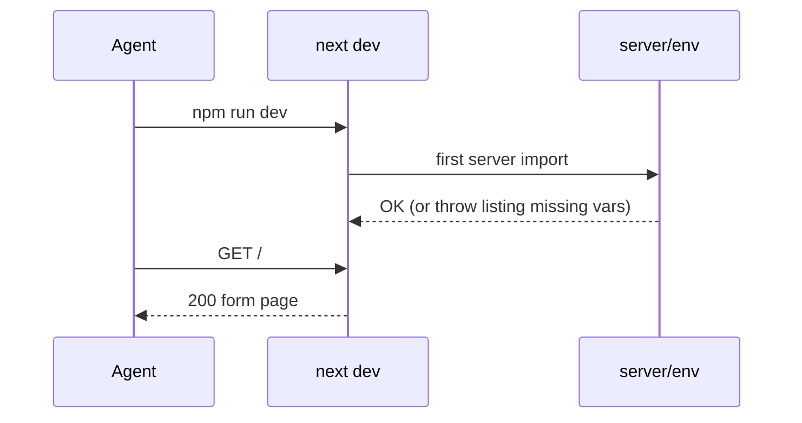

# ADR-001: Project Setup and Tooling

**Date:** 2026-10-18
**Status:** Accepted
**Relates to:** `docs/ADR/000-main-architecture.md`

---

## 1. Scope

This ADR covers initializing the Next.js app in the empty `app/` folder, dependencies, TypeScript strictness, linting, test runners, scripts and environment files. It does not cover feature code (ADR 002–004).

---

## 2. Technology Documentation References

| Library | Context7 ID or official docs | Used for |
|---|---|---|
| Next.js / create-next-app 16.4 | `/vercel/next.js` | Scaffold, App Router, config |
| AI Elements CLI 1.9 | `/vercel/ai-elements` | Installing chat components (sets up shadcn/ui if missing) |
| shadcn/ui | https://ui.shadcn.com/docs | Base UI primitives (button, dialog, select, …) |
| Vercel AI SDK 7 | `/vercel/ai` | `ai`, `@ai-sdk/react`, `ai/test` |
| OpenRouter provider 3 | `/openrouterteam/ai-sdk-provider` | Model provider |
| Vitest | https://vitest.dev | Unit and integration tests |
| Playwright | https://playwright.dev | E2E |

---

## 3. Component Design — Initialization Procedure

The implementing agent runs these steps in order from the repo root. Each step is verified before the next one.

1. **Clear the target folder conflict.** `create-next-app` refuses non-empty folders. Its allow-list includes `.gitignore`, `.git`, `docs`, `.claude` and a few others, but **not** `README.md`. `app/README.md` (the course checklist) must be moved out first (to the scratchpad), then merged back into the generated `app/README.md` after scaffolding.
2. **Scaffold non-interactively with pinned version:**
   `npx create-next-app@16.4.2 app --ts --tailwind --eslint --app --src-dir --import-alias "@/*" --use-npm --yes`
   - `--yes` keeps the remaining defaults (Turbopack) and generates `app/AGENTS.md` with up-to-date Next.js guidance for agents.
   - The repo root is already a git repo, so verify afterwards that **no nested `app/.git`** was created (delete it if present).
3. **Install runtime dependencies (exact versions, `--save-exact`):** `ai@7.0.143`, `@ai-sdk/react@4.0.147`, `@openrouter/ai-sdk-provider@3.1.0`, `zod@4.6.7`, `sharp@0.35.5`, `file-type@22.2.0`, `server-only`. Form: `react-hook-form` + `@hookform/resolvers` (Zod 4 compatible versions current at install time).
4. **Initialize shadcn/ui, then add AI Elements through the shadcn registry.** The `ai-elements` CLI (1.9.1) prompts interactively and warns that it will be deprecated at the end of November 2026 in favor of shadcn/ui. Run non-interactively with stdin closed:
   - `npx shadcn@latest init -t next -b radix -p nova --no-monorepo --css-variables -y`. This creates `components.json` (style `radix-nova`) and `src/lib/utils.ts`. Generated components import `cn` from the shadcn-maintained `cn` package.
   - `npx shadcn@latest add @ai-elements/conversation @ai-elements/message @ai-elements/prompt-input -y`. `@ai-elements/loader` no longer exists in the registry, so use the shadcn `spinner` (installed as a dependency) for loading states.
   - `npx shadcn@latest add alert alert-dialog radio-group label badge card collapsible -y`. `button`, `select`, `input`, `textarea`, `dialog` and `tooltip` come in with AI Elements.
   - Move `shadcn` to `devDependencies` (the CLI adds it as a runtime dependency).
5. **Install dev dependencies:** `@types/node@^24` (the scaffold's `^20` conflicts with Vitest 5's peer range), `vitest`, `jsdom`, `@testing-library/react`, `@testing-library/user-event`, `@testing-library/jest-dom` and `@playwright/test`. Then run `npx playwright install chromium`. Do **not** add `@vitejs/plugin-react` (an unresolvable Babel 8 peer conflict with the shadcn CLI) or `vite-tsconfig-paths` (`resolve.tsconfigPaths: true` is built in). Vitest's default transform handles TSX with the automatic JSX runtime. Alias `server-only` to an empty stub in the Vitest configs, because the real package throws outside the `react-server` condition.
6. **Harden TypeScript:** in `tsconfig.json` keep `strict: true` (scaffold default) and add `noUncheckedIndexedAccess: true`, `noImplicitOverride: true`, `noFallthroughCasesInSwitch: true` and `forceConsistentCasingInFileNames: true`. Generated AI Elements/shadcn files must compile under these flags. Fix them in place if not, because they are owned code.
7. **Configure Next.js:** `next.config.ts` with `serverExternalPackages: ['sharp']` (native module) and `typedRoutes: true`. No `proxy`/middleware (it would add a body-size limit to uploads).
8. **Create env files:** `app/.env.example` listing the ADR-000 §7 variables, and `app/.env.local` (git-ignored) copied from the root `.env` values. Add `server/env.ts` with Zod validation.
9. **Add scripts** to `package.json`: `dev`, `build`, `start`, `lint`, `typecheck` (`tsc --noEmit`), `test` (vitest run, unit + integration), `test:watch`, `test:eval` (vitest with `vitest.eval.config.ts`), `test:e2e` (playwright test).
10. **Configure tests:** `vitest.config.ts` with two projects, `unit` (jsdom, `tests/unit/**`, `src/**/*.test.tsx`) and `integration` (node, `tests/integration/**`). A setup file registers jest-dom matchers and a global `fetch` guard that fails any request to `openrouter.ai` (TAC-03). `playwright.config.ts` uses `webServer: npm run build && npm run start` on port 3000, `baseURL http://localhost:3000`, Chromium plus a 375 px-wide mobile project, and a timeout of 120 s per test (real LLM).
11. **Extend `app/AGENTS.md`** (keep the generated Next.js block) with: commands (step 9), the `src/server` server-only rule, "AI SDK 7 APIs only (`instructions`, `isStepCount`, `Output.object`, `toUIMessageStream`); no `generateObject`/`stepCountIs`/`toDataStreamResponse`", and links to these ADRs.
12. **Verify:** `npm run typecheck && npm run lint && npm test && npm run build` all exit 0, and `npm run dev` serves `/` with 200.

---

## 4. Data Structures

The target folder layout after setup (feature folders are created empty and filled in ADR 002–004):

```
app/
  src/app/{layout.tsx,page.tsx,globals.css}
  src/app/api/cases/route.ts
  src/app/api/cases/[caseId]/route.ts
  src/app/api/cases/[caseId]/chat/route.ts
  src/components/{ui,ai-elements,case}/
  src/lib/{domain,schemas,i18n}/
  src/server/{env.ts,store,image,ai,policies}/
  tests/{unit,integration,eval,e2e,fixtures/llm}/
```

---

## 5. Interface Contracts

| Command | Contract |
|---|---|
| `npm run dev` | Starts on `http://localhost:3000` and fails fast if required env vars are missing |
| `npm test` | Unit + integration. Exit 0 with no network. |
| `npm run test:eval` | Requires `OPENROUTER_API_KEY` and makes real model calls |
| `npm run test:e2e` | Builds, starts and runs Playwright. Requires `OPENROUTER_API_KEY`. |

---

## 6. Technical Decisions

### S1 — `create-next-app` with pinned version and explicit flags
**Status:** Accepted · **Date:** 2026-10-18
**Context:** The agent starts from an empty `app/` and must produce a reproducible scaffold without interactive prompts.
**Decision:** Pin `create-next-app@16.4.2` and pass all flags plus `--yes`. Use `--src-dir` to separate source from config files.
**Rejected alternatives:**
- `--example` / Vercel chatbot template: it brings auth, a DB and storage that are out of scope (see ADR-000 D2).
- Manual setup without the CLI: the repo guide says not to hand-create configs the boilerplate provides.
**Consequences:** (+) A deterministic scaffold with a generated agent guide. (–) The `app/README.md` conflict needs the move-and-merge step.
**Review trigger:** A Next.js major upgrade.

### S2 — AI Elements CLI as the shadcn initializer
**Status:** Accepted · **Date:** 2026-10-18
**Context:** AI Elements requires shadcn/ui, and its CLI sets it up when missing.
**Decision:** Run AI Elements before the other shadcn components, so one `components.json` is created with CSS variables (needed for brand tokens, ADR-004).
**Rejected alternatives:** Running `shadcn init` manually first. It works, but adds a step with prompts.
**Consequences:** (+) One consistent registry config. (–) The CLI is network-dependent, so the step must be retried if the registry is unreachable.
**Review trigger:** AI Elements changes its install method.

### S3 — Exact dependency versions
**Status:** Accepted · **Date:** 2026-10-18
**Context:** AI SDK 7 and the provider are fast-moving, and API names changed between majors.
**Decision:** Use `--save-exact` for `ai`, `@ai-sdk/react`, `@openrouter/ai-sdk-provider` and `zod`, and commit `package-lock.json`.
**Rejected alternatives:** Caret ranges, which risk silent minor-version behavior changes during the course.
**Consequences:** (+) Reproducible installs. (–) Upgrades are manual.
**Review trigger:** Security advisories or a needed feature.

---

## 7. Diagrams

### Setup flow
```mermaid
flowchart TD
  A[Move app/README.md to scratchpad] --> B[create-next-app@16.4.2 app --yes ...]
  B --> C{nested app/.git?}
  C -- yes --> C1[remove it] --> D
  C -- no --> D[npm i runtime deps --save-exact]
  D --> E[shadcn init radix/nova + add @ai-elements/conversation, message, prompt-input]
  E --> F[shadcn add primitives]
  F --> G[dev deps + playwright install chromium]
  G --> H[tsconfig hardening + next.config]
  H --> I[env files + env validation]
  I --> J[scripts + vitest/playwright config]
  J --> K[merge README, extend AGENTS.md]
  K --> L{typecheck, lint, test, build OK?}
  L -- no --> M[fix] --> L
  L -- yes --> N[commit 'App: scaffold Next.js + AI SDK']
```

### Sequence — first run


---

## 8. Testing Strategy

### Test scenarios for this area

| Scenario | Type | Input | Expected output | Edge cases |
|---|---|---|---|---|
| Env validation | Unit | Env missing `OPENROUTER_API_KEY` | Throws an error naming the variable | `LLM_MODEL` empty string is treated as missing |
| Model fallback | Unit | Only `LLM_MODEL` set | Vision and decision model IDs equal `LLM_MODEL` | Only `VISION_MODEL` set → decision uses `LLM_MODEL` |
| Network guard | Unit | Test calls `fetch('https://openrouter.ai/...')` | Test fails with a guard message | – |
| Scaffold health | Script | `typecheck`, `lint`, `test`, `build` | All exit 0 | Generated AI Elements files compile under the strict flags |

### Technical acceptance criteria
- **TAC-001-01** `app/package.json` pins `ai`, `@ai-sdk/react`, `@openrouter/ai-sdk-provider` and `zod` to exact versions.
- **TAC-001-02** `tsconfig.json` contains `strict: true` and `noUncheckedIndexedAccess: true`.
- **TAC-001-03** There is no `app/.git` directory, and the repo root `git status` shows the scaffold as normal files.
- **TAC-001-04** `app/.env.example` lists every variable in ADR-000 §7, and `.env.local` is git-ignored.
- **TAC-001-05** All four checks in step 12 exit 0 on a clean clone after `npm ci`.
