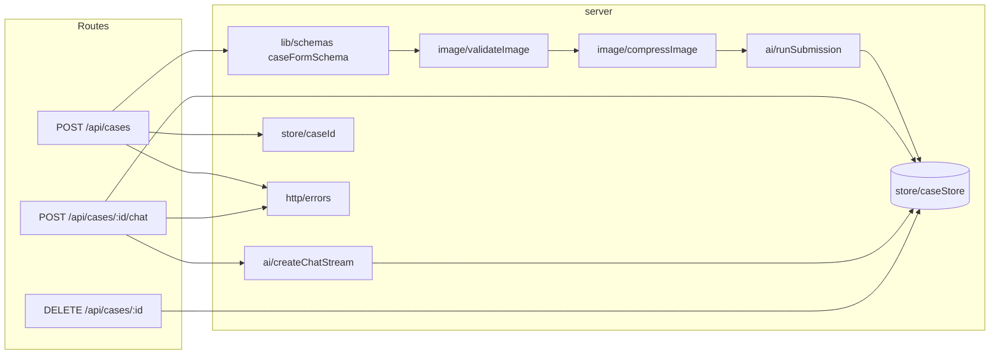
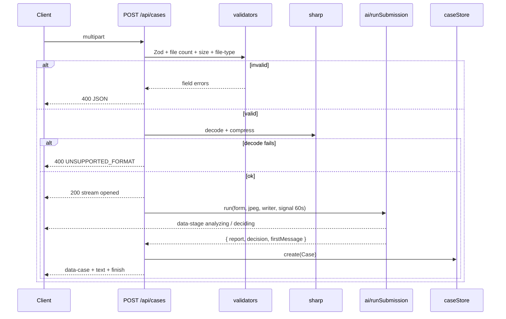
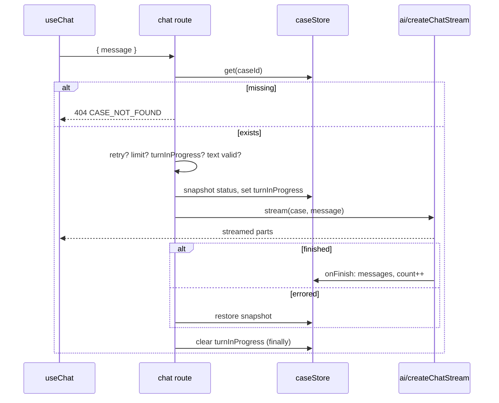

# ADR-002: Backend API, Case Store and Image Processing

**Date:** 2026-10-18
**Status:** Accepted
**Relates to:** `docs/ADR/000-main-architecture.md`

---

## 1. Scope

This ADR covers the route handlers, request validation, the in-memory case store, image validation and compression, stream composition for submission and error handling. It does not cover prompts, model calls or the tool logic (ADR-003), or the UI (ADR-004).

---

## 2. Technology Documentation References

| Library | Context7 ID or official docs | Used for |
|---|---|---|
| Next.js route handlers | `/vercel/next.js` | `POST`/`DELETE` handlers, `request.formData()`, `maxDuration` (no `runtime` export with Cache Components) |
| AI SDK UI stream | `/vercel/ai` | `createUIMessageStream`, `createUIMessageStreamResponse`, `toUIMessageStream`, data parts (transient + persistent) |
| sharp | https://sharp.pixelplumbing.com/api-resize | Rotate, resize, JPEG output, metadata stripping |
| file-type | https://github.com/sindresorhus/file-type | Magic-byte detection |
| Zod 4 | https://zod.dev | Request validation |

---

## 3. Component Design

| Component | Responsibility |
|---|---|
| `app/api/cases/route.ts` (POST) | Parses multipart, validates, processes the image, runs the pipeline inside `createUIMessageStream`, stores the Case on success |
| `app/api/cases/[caseId]/chat/route.ts` (POST) | Loads the Case, validates the message and limits, delegates to `server/ai/createChatStream`, persists on finish |
| `app/api/cases/[caseId]/route.ts` (DELETE) | Removes the Case and returns 204 |
| `server/image/validateImage` | Checks size ≤ 10 485 760 bytes, then `file-type` detection. Allowed MIME types: `image/jpeg`, `image/png`, `image/webp`. The extension and client-declared type are ignored. |
| `server/image/compressImage` | sharp pipeline: `rotate()` (apply EXIF orientation) → `resize` fit `inside` 1568×1568, `withoutEnlargement` → flatten alpha on white → `jpeg` quality 80, mozjpeg → no metadata. Returns `{ bytes, mediaType: 'image/jpeg', width, height }`. Images already within 1568 px are still re-encoded (uniform input, EXIF stripped). |
| `server/store/caseStore` | `create(caseDraft)`, `get(id)`, `update(id, mutator)`, `delete(id)`, `sweep()`. A `Map` on `globalThis.__hscCaseStore`. `get` refreshes `lastActivityAt`. Entries are expired when idle longer than `CASE_TTL_MINUTES`. At more than 500 entries, the entry with the oldest `lastActivityAt` is evicted. |
| `server/store/caseId` | `HSC-` + date `YYYYMMDD` (Europe/Warsaw, via `Intl.DateTimeFormat`) + `-` + 4 chars from `A–Z0-9` using `crypto.getRandomValues`. Regenerated on collision with an existing key. |
| `server/http/errors` | Maps internal errors to stable codes. Never serializes stack traces or upstream messages (AC-36). Logs `{ caseId?, code, cause }` via `console.error`. |

The route handlers export `maxDuration = 60`. They run on the Node.js runtime, which is the default and the only runtime with `cacheComponents: true`; the `runtime` segment config is rejected by the build in that mode (`node_modules/next/dist/docs/01-app/03-api-reference/03-file-conventions/02-route-segment-config/runtime.md`). The pipeline uses one `AbortSignal.timeout(60_000)`, created at request start and passed to both model calls (PRD AC-34). The chat route uses its own 60 s signal per turn.

The store mutations are synchronous within one event-loop tick, so no locks are needed in a single process. The chat route rejects a second concurrent turn for the same case with 409 `TURN_IN_PROGRESS`, using a `turnInProgress` flag on the Case that is cleared in `finally`.

---

## 4. Data Structures

**Create-case request (multipart field names):** `caseType`, `category`, `modelName`, `purchaseDate` (`YYYY-MM-DD`), `reason`, `image`. Validated by the shared `caseFormSchema` (`lib/schemas`) plus the server-only file checks.

**Validation error body (400):** `{ error: 'VALIDATION', fields: { [field]: ErrorCode } }`. ErrorCodes: `REQUIRED`, `TOO_SHORT`, `TOO_LONG`, `FUTURE_DATE`, `INVALID_ENUM`, `UNSUPPORTED_FORMAT`, `FILE_TOO_LARGE`, `MULTIPLE_FILES`. The client maps the codes to Polish strings from `lib/i18n/pl` (the same strings as AC-03/04/07/08/09).

**Submission stream parts (in order):**
1. `start`
2. `data-stage` `{ stage: 'analyzing' }`, **transient**
3. `data-stage` `{ stage: 'deciding' }`, **transient**
4. `data-case` `{ caseId, caseType, category, modelName, purchaseDate, reason, status }`, persistent (the summary panel reads it)
5. `text-start` / `text-delta` (the whole composed markdown in one or more deltas) / `text-end`
6. `finish`

On failure, the stream emits an `error` chunk with the text `PROCESSING_FAILED` (`createUIMessageStream` `onError` returns that constant) and then closes.

**Chat request body:** `{ message: HscUIMessage }`, where the message has `role: 'user'`, exactly one text part, and text trimmed to 1–2000 chars.

**Chat error bodies:** `404 { error: 'CASE_NOT_FOUND' }`, `409 { error: 'MESSAGE_LIMIT' }`, `409 { error: 'TURN_IN_PROGRESS' }`, `400 { error: 'VALIDATION' }`.

---

## 5. Interface Contracts

### `POST /api/cases`
- **Input:** multipart as above. Exactly one `image` file.
- **Pre-stream checks (synchronous, before any model call):** Zod form validation → image count → size → magic bytes → sharp decode (a corrupt file → `UNSUPPORTED_FORMAT`). Any failure → 400 JSON.
- **Output:** 200 `text/event-stream` UI message stream (§4).
- **Side effects:** Case stored **only** after the decision succeeds and the first message is composed. The compressed image is discarded after analysis.
- **Errors in stream:** model error, timeout, schema-invalid model output (after the AI SDK's own retries) → `PROCESSING_FAILED`.

### `POST /api/cases/{caseId}/chat`
- **Input:** JSON `{ message }`, sent from the client's `DefaultChatTransport.prepareSendMessagesRequest` as the last message only.
- **Checks:** Case exists (404). `turnInProgress` (409). If `message.id` already exists in `case.messages`, it's a retry: do not append and do not count. Otherwise, `userMessageCount` must be < 20 (409 `MESSAGE_LIMIT`). Text validation (400).
- **Output:** 200 UI message stream from `server/ai/createChatStream` (ADR-003), with `originalMessages = case.messages + message`.
- **Side effects (in `onFinish` of `toUIMessageStream`):** `case.messages` = the returned full list, `userMessageCount += 1` (non-retry only), `lastActivityAt` = now. The tool `execute` updates the status fields (ADR-003). If the stream errors before finish, nothing is persisted except tool side effects that have already run. These are rolled back by restoring a snapshot of `currentStatus`/`statusHistory`/`needsInfoRounds` taken at turn start.

### `DELETE /api/cases/{caseId}`
- **Output:** 204 always. Idempotent.

---

## 6. Technical Decisions

### B1 — Image compression targets: 1568 px longest side, JPEG q80
**Status:** Accepted · **Date:** 2026-10-18
**Context:** The PRD (AC-12, §12) defers compression targets to the ADR. The sample inputs range from 387×516 px / 15 KB to 3024×3135 px / 1.2 MB, with WebP and a JPEG-in-`.png`. Vision models downscale large inputs anyway, and base64 inflates the payload by about 33%.
**Decision:** Fit within 1568×1568 without enlarging, re-encode as JPEG q80, strip metadata and apply EXIF rotation. 1568 px keeps enough detail for scratches and cracks, and the result is typically 150–400 KB.
**Rejected alternatives:**
- Sending originals: large payloads and EXIF/GPS leakage to third parties.
- 1024 px: risks losing small defects (hairline cracks) on full-device photos.
**Consequences:** (+) Bounded payload, privacy (no GPS EXIF) and uniform input for evals. (–) Fine detail beyond 1568 px is lost, and the JPEG re-encode loses PNG transparency (irrelevant for photos).
**Review trigger:** Eval shows missed small defects, or a model's documented optimal input size changes.

### B2 — Format detection by magic bytes on both sides
**Status:** Accepted · **Date:** 2026-10-18
**Context:** AC-08 requires content-based detection, and `laptop-1.png` is a JPEG.
**Decision:** Use `file-type` (`fileTypeFromBlob` on the client, `fileTypeFromBuffer` on the server). The server check is authoritative, and sharp decode is the final gate.
**Rejected alternatives:** Extension or `File.type` checks only, which accept spoofed files and reject `laptop-1.png`.
**Consequences:** (+) Correct handling of mislabelled files. (–) An extra dependency in the client bundle (small, tree-shaken).
**Review trigger:** HEIC support is requested (out of scope today).

### B3 — Retry idempotency by message ID
**Status:** Accepted · **Date:** 2026-10-18
**Context:** AC-35 requires "Ponów" to resend the same message without duplicating it.
**Decision:** The server treats an incoming user message whose `id` already exists in history as a retry. The client retry uses `useChat().regenerate()`, which resends the same last user message.
**Rejected alternatives:** A client-generated idempotency header (duplicates the existing message ID).
**Consequences:** (+) Simple and testable. (–) Relies on stable client message IDs (the AI SDK default).
**Review trigger:** Message editing is added.

---

## 7. Diagrams

### Component diagram

### Sequence — submission validation and stream composition

### Sequence — chat turn bookkeeping

---

## 8. Testing Strategy

### Test scenarios for this area

| Scenario | Type | Input | Expected output | Edge cases |
|---|---|---|---|---|
| Form schema | Unit | Each AC-03–07 violation | The right ErrorCode per field | Reason exactly 20 chars is OK for a complaint; purchase date today is OK; tomorrow (Warsaw time) → `FUTURE_DATE` |
| Magic bytes | Integration | Every file in `assets/example-images/` | Accepted, detected as jpeg/webp | `laptop-1.png` → `image/jpeg`; a `.txt` renamed `.jpg` → `UNSUPPORTED_FORMAT` |
| Size limit | Unit | 10 485 760 bytes / 10 485 761 bytes | OK / `FILE_TOO_LARGE` | – |
| Compression | Integration | `laptop-1.png` (3024×3135) | JPEG, longest side 1568, no EXIF | `phone-2.jpeg` (387×516) is not enlarged |
| Case ID | Unit | Fixed clock 2026-10-18 23:30 UTC | `HSC-20261019-XXXX` (Warsaw is already the 19th) | Collision → regenerated |
| Store TTL | Unit | Fake timers, 121 min idle | `get` returns undefined | `get` at 119 min extends the TTL |
| Store cap | Unit | 501 creates | Oldest evicted, size 500 | – |
| Submit happy path | Integration | Valid multipart, mocked models | Stream order per §4, Case stored, `data-case.caseId` matches the regex | – |
| Submit failure | Integration | Vision mock throws | Stream `error` = `PROCESSING_FAILED`, store empty | Decision mock times out (fake 60 s) |
| No leak | Integration | Mock throws an Error containing "sk-or-…" | Response body has no stack, key or model ID | – |
| Chat 404 | Integration | Unknown ID | 404 `CASE_NOT_FOUND` | – |
| Chat limit | Integration | 20 stored user messages + a new one | 409 `MESSAGE_LIMIT` | Retry of the 20th message is still allowed |
| Chat retry | Integration | The same message ID twice (first errored) | One user message in history, count 1 | – |
| Concurrent turn | Integration | Second POST while the first is streaming | 409 `TURN_IN_PROGRESS` | – |
| Delete | Integration | DELETE twice | 204, 204 | – |

### Technical acceptance criteria
- **TAC-002-01** Every 400/404/409 response body is one of the documented shapes, and none contains `stack`, `OPENROUTER`, `sk-or` or a model ID.
- **TAC-002-02** The vision model receives `mediaType: image/jpeg` and bytes whose decoded longest side is ≤ 1568 px, for all sample images.
- **TAC-002-03** After a failed submission, the store size is unchanged.
- **TAC-002-04** A retried chat message is never stored twice and never counted twice.
- **TAC-002-05** The route handlers run on the Node.js runtime and do not export `runtime` (incompatible with `cacheComponents`); `npm run build` lists them as dynamic (ƒ).
