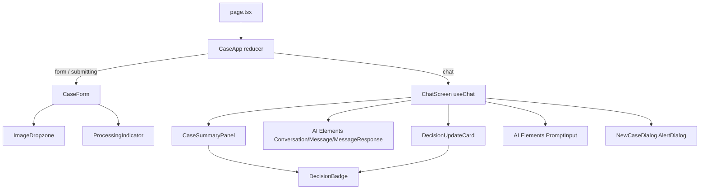
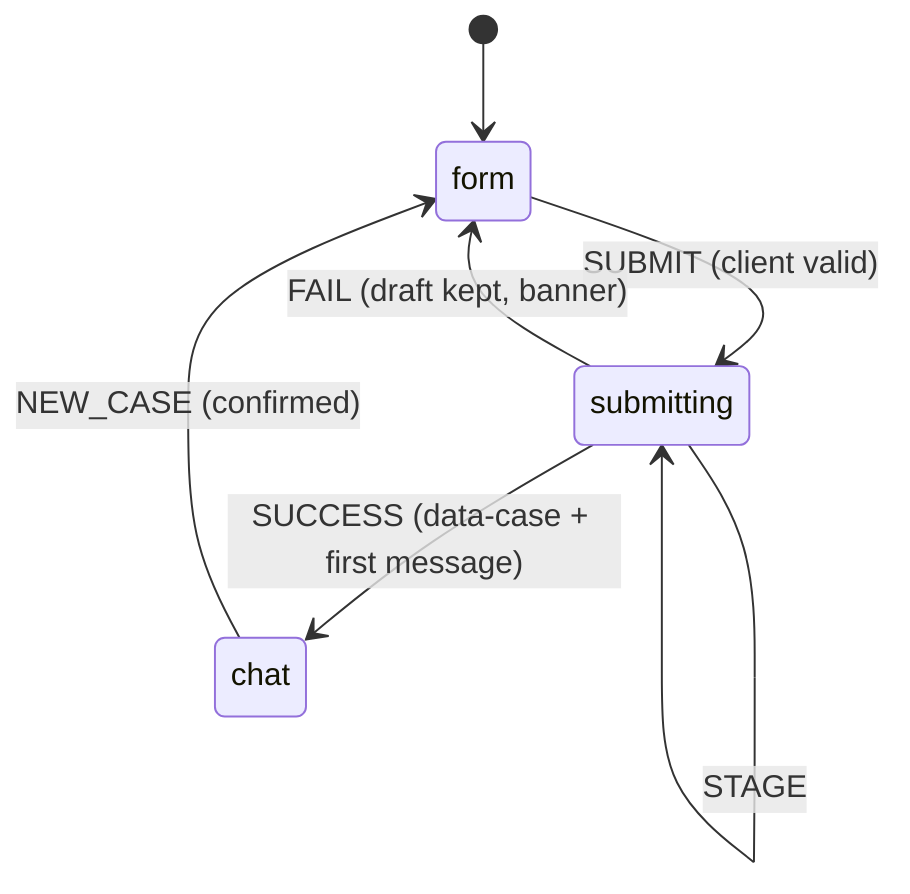
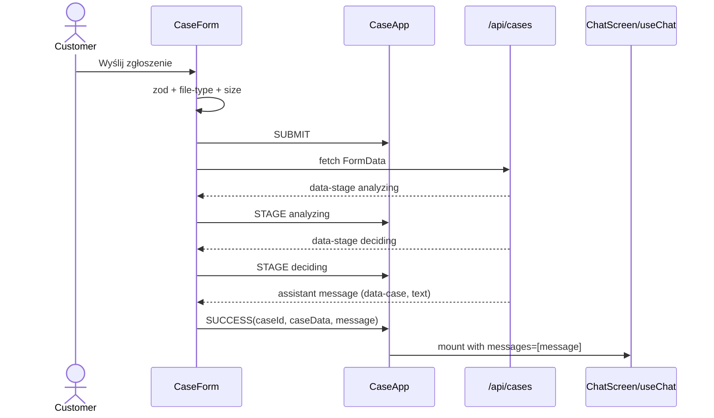
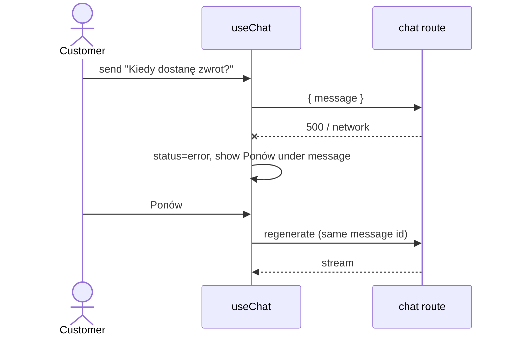

# ADR-004: Frontend — Screens, AI Elements Chat and Client State

**Date:** 2026-10-18
**Status:** Accepted
**Relates to:** `docs/ADR/000-main-architecture.md`

---

## 1. Scope

This ADR covers the single page, the client state machine, the case form, consuming the submission stream, the chat with `useChat` + AI Elements, the case summary panel, error, limit and leave-page handling, and styling with the brand tokens. It does not cover server logic (ADR-002/003).

---

## 2. Technology Documentation References

| Library | Context7 ID or official docs | Used for |
|---|---|---|
| AI SDK UI (`@ai-sdk/react` 4) | `/vercel/ai` | `useChat` (`id`, `messages`, `transport`, `status`, `error`, `regenerate`, `onError`), `DefaultChatTransport` (`api`, `prepareSendMessagesRequest`), `readUIMessageStream` |
| AI Elements | `/vercel/ai-elements` | `Conversation`/`ConversationContent`/`ConversationScrollButton`, `Message`/`MessageContent`/`MessageResponse`, `PromptInput*`, `Loader` |
| shadcn/ui | https://ui.shadcn.com/docs | Form primitives, AlertDialog, Badge, Collapsible |
| react-hook-form + Zod resolver | https://react-hook-form.com | Form state with the shared `caseFormSchema` |
| file-type (browser) | https://github.com/sindresorhus/file-type | `fileTypeFromBlob` for AC-08 |
| Design reference | `docs/design-guidelines.md`, `assets/design-tokens.json`, `assets/homepage.png`, `assets/logo.png` | Theme tokens and logo |

---

## 3. Component Design

### Page and state machine
`src/app/page.tsx` is a server component that renders `<CaseApp />` (client). `CaseApp` holds a reducer state:

| State | Data | Renders |
|---|---|---|
| `form` | `draft` (form values + `File`), `bannerError?` | `CaseForm` |
| `submitting` | `draft`, `stage: 'analyzing' \| 'deciding'` | `CaseForm` (disabled) + `ProcessingIndicator` |
| `chat` | `caseId`, `caseData` (from `data-case`), `firstMessage`, `imagePreviewUrl` | `ChatScreen` |

Transitions: `SUBMIT` → submitting. `STAGE` updates the stage. `SUCCESS` → chat. `FAIL` → form with the draft kept and the banner set (AC-34). `NEW_CASE` → form (empty, revoke the object URL). There are no routes or URL changes (PRD §9.3).

### Case form (`components/case/CaseForm`)
- react-hook-form with `zodResolver(caseFormSchema)` (the same schema as the server), `mode: 'onSubmit'`, then `reValidateMode: 'onChange'`. Focus moves to the first invalid field on submit.
- Fields, labels, placeholders and hints as in PRD §9.1, with strings from `lib/i18n/pl`. The case-type choice switches the reason label and requirement and the photo hint.
- Date input: native `<input type="date">` with `max` = today (Europe/Warsaw), plus a schema check (AC-07).
- Reason textarea with a live counter `n/2000` and `maxLength`.
- `ImageDropzone`: a single file. On select, the size check runs first (AC-09), then `fileTypeFromBlob` (AC-08). It shows a preview (`URL.createObjectURL`), the name and size (KB/MB, Polish formatting) and **Usuń**. Selecting a new file replaces the old one and revokes the previous URL (AC-10).
- Submit: `fetch('/api/cases', { method: 'POST', body: FormData })`. If the response is 400, map `fields` codes to inline errors. If it's 200, decode the SSE body into `UIMessageChunk`s (use the AI SDK's exported SSE/UI-chunk parser, and check the current name via Context7 `/vercel/ai` before implementing), then pass them to `readUIMessageStream`. Each yielded message updates the state: transient `data-stage` parts are taken from chunks (handled before message assembly), and the final message provides `data-case` + text. An error chunk or a network error → `FAIL`.
- While submitting, every field and button is disabled (AC-11).

### Processing indicator
Shows "Analizujemy zdjęcie…" then "Przygotowujemy decyzję…", driven by real `data-stage` parts. It uses the AI Elements `Loader` and `aria-live="polite"`.

### Chat screen (`components/case/ChatScreen`)
- `useChat<HscUIMessage>({ id: caseId, messages: [firstMessage], transport: new DefaultChatTransport({ api: '/api/cases/' + caseId + '/chat', prepareSendMessagesRequest: ({ messages }) => ({ body: { message: last(messages) } }) }) })`. The server holds the history (ADR-000 D3).
- Layout: on screens ≥ 1024 px, a two-column grid (summary panel 320 px on the left, conversation on the right). Below 1024 px, the panel is a shadcn `Collapsible` above the conversation, collapsed by default (AC-40).
- Conversation: `Conversation` > `ConversationContent` > per message `Message from={role}` > `MessageContent` > parts:
  - `text` → `MessageResponse` (streaming markdown, AC-26)
  - `data-case` → not rendered in the bubble (it feeds the panel)
  - `tool-updateDecision`: `input-streaming`/`input-available` → a small "Aktualizuję decyzję…" row; `output-available` → `DecisionUpdateCard` (title "Zaktualizowana decyzja", status badge, reason, refs, disclaimer, AC-30); `output-error` → nothing (the model's text explains)
  - A timestamp from `metadata.createdAt` under each message.
  - `ConversationScrollButton` for auto-scroll.
- Typing indicator: when `status` is `submitted` or `streaming`, a `Loader` row is shown at the bottom, and `PromptInputSubmit` receives `status` (disabled while busy, AC-29).
- Input: `PromptInput` + `PromptInputTextarea` (`maxLength` 2000, counter, Enter submits, Shift+Enter adds a newline, whitespace-only blocked, AC-28). Attachments are not enabled (PRD §7).
- Errors: `useChat` `onError` inspects the response. A 409 `MESSAGE_LIMIT` puts the screen in the limit state. A 404 `CASE_NOT_FOUND` shows "Sesja wygasła. Rozpocznij nowe zgłoszenie." with the New-case button. Anything else marks the last user message with an error icon and a **Ponów** button that calls `regenerate()` (AC-35). Raw error text is never shown (AC-36).
- Limit state: the client counts user messages in `messages`. At 20, it disables the input and shows the AC-33 text (the server enforces it too).
- Header: logo, title and a **Nowe zgłoszenie** button → `AlertDialog` with the PRD §4.7 text. Confirm → `fetch DELETE` (fire-and-forget) → `NEW_CASE`. Cancel → no change (AC-38).
- Leave-page guard: a `beforeunload` listener is active while the state is `chat` (AC-37) and removed on `NEW_CASE`.

### Case summary panel
Shows the case ID, type, category, model, purchase date (formatted `dd.MM.yyyy`), the reason (3-line clamp + "Pokaż więcej"), a thumbnail from the client object URL (click opens an `AlertDialog`/`Dialog` with the full image) and the `DecisionBadge`. **Current status** = the `status` of the last `tool-updateDecision` output in `messages`, falling back to `data-case.status`. This is derived and not stored separately.

### Decision badge
A shadcn `Badge` variant per status with the Polish label from `lib/domain`. It never relies on color alone: the label text is always present.

### Styling
- Tailwind 4 theme variables in `globals.css` (`@theme` + shadcn CSS variables `--primary`, `--background`, …) are mapped from `assets/design-tokens.json` per `docs/design-guidelines.md`. The logo is copied to `public/logo.png` and the favicon is copied over.
- Manual QA compares screenshots with `assets/homepage.png` (AGENTS.md).
- Accessibility: every field has a `<label>`, errors are linked via `aria-describedby`, and the chat log uses `role="log"` with `aria-live="polite"`.

---

## 4. Data Structures

- **CaseDraft:** form values + `File | null`. It is kept in the reducer across `FAIL` so the data is retained (AC-34).
- **HscUIMessage:** see ADR-000 §5. It is shared from `lib/schemas` as a type.
- **Polish strings:** `lib/i18n/pl` exports an object grouped by screen (form, processing, chat, errors, dialog). No string literals in components.

---

## 5. Interface Contracts (client → server)

| Action | Request | Handling |
|---|---|---|
| Submit | `POST /api/cases` multipart | 400 → inline field errors. 200 stream → stages → `SUCCESS`. Stream error or network → `FAIL` + banner. |
| Send / retry chat message | `useChat` → `POST /api/cases/{id}/chat` `{ message }` | Streamed parts are rendered live. Errors as in §3. |
| New case | `DELETE /api/cases/{id}` | Response ignored |

---

## 6. Technical Decisions

### F1 — AI Elements over assistant-ui and custom components
See ADR-000 D6. In addition: AI Elements' `PromptInputSubmit` accepts `useChat().status` directly, and `MessageResponse` handles incomplete markdown mid-stream, which covers AC-26 and AC-29 without custom code.

### F2 — The submission stream is consumed manually, chat via `useChat`
**Status:** Accepted · **Date:** 2026-10-18
**Context:** The submission is multipart with a file and isn't a chat message, but it returns the same UI message stream protocol.
**Decision:** The form posts `FormData` with `fetch` and decodes the body with the AI SDK stream utilities (`readUIMessageStream`). The resulting first `UIMessage` seeds `useChat({ messages })`.
**Rejected alternatives:** Sending the form as the first `useChat` message with a file part. The file would go to the chat route (the wrong boundary), and it would appear as a user bubble that the PRD doesn't show.
**Consequences:** (+) Clean separation and the same message format in both places. (–) About 30 lines of stream-handling code, covered by unit tests.
**Review trigger:** The AI SDK adds a first-class non-chat stream hook that fits the flow.

### F3 — Single page with a reducer, no client router or state library
**Status:** Accepted · **Date:** 2026-10-18
**Context:** Three states, one screen at a time, no URLs (PRD §9.3).
**Decision:** `useReducer` in `CaseApp`, with props passed down.
**Rejected alternatives:** Zustand/Redux (unneeded) and routes per state (the PRD forbids URL-addressable cases).
**Consequences:** (+) Minimal. (–) Reload loses everything, which is intended (AC-37).
**Review trigger:** Persistence and case history are added.

---

## 7. Diagrams

### Component diagram

### State machine

### Sequence — submit to chat (client view)

### Sequence — chat error and retry (client view)

---

## 8. Testing Strategy

### Test scenarios for this area

| Scenario | Type | Input | Expected output | Edge cases |
|---|---|---|---|---|
| Required fields | Unit (RTL) | Submit an empty form | "To pole jest wymagane" under 5 fields, focus on the first, no fetch (AC-03) | Reason not required for Zwrot (AC-05) |
| Complaint reason | Unit | Reklamacja + 19 chars | "Opisz problem (min. 20 znaków)" (AC-04) | 20 chars OK |
| Counter | Unit | Type 2000 chars | Counter `2000/2000`, further input blocked (AC-06) | – |
| Future date | Unit | Tomorrow | "Data zakupu nie może być z przyszłości" (AC-07) | – |
| File checks | Unit | PDF renamed `.jpg`; an 11 MB JPEG | Format error; size error (AC-08/09) | JPEG named `.png` accepted |
| Replace image | Unit | Select two files | One preview, the first URL revoked (AC-10) | – |
| Disabled while submitting | Unit | Pending fetch | All inputs disabled, a second click does nothing (AC-11) | – |
| Stream handling | Unit | Mock fetch with a recorded stream fixture | Stage labels in order, then the chat state | Error chunk → form + banner + draft kept (AC-34) |
| Message rendering | Unit | Messages with text, `tool-updateDecision` output, `data-case` | Markdown rendered as HTML headings/lists (AC-26), the card with "Zaktualizowana decyzja" (AC-30), `data-case` not shown | – |
| Panel status | Unit | Initial ACCEPTED, later tool output MANUAL_REVIEW | Badge "Do weryfikacji przez specjalistę" | – |
| Typing state | Unit | `status=streaming` | Loader visible, submit disabled (AC-29) | – |
| Limit | Unit | 20 user messages | Input disabled + AC-33 text | – |
| Retry | Unit | `useChat` error | Ponów visible, calls `regenerate` (AC-35) | 404 → session expired message |
| New case | Unit | Confirm / cancel | Empty form / unchanged chat (AC-38) | – |
| beforeunload | Unit | Chat state | Listener registered, removed after NEW_CASE (AC-37) | – |
| **E2E return** | E2E | Zwrot, Smartfon, purchase today −3 d, `phone-1.jpg` | Chat opens, first message has a badge, "Następne kroki", the disclaimer and a case ID (AC-23–25) | Status is not asserted (it depends on the image) |
| **E2E complaint** | E2E | Reklamacja, Laptop, today −400 d, reason 40 chars, `laptop-2.webp` | Same structure. Send "Co dalej?" → a streamed reply appears, input re-enabled | – |
| **E2E late return** | E2E | Zwrot, purchase −30 d, `phone-2.jpeg` | Badge "Odrzucone" (date rule, independent of the image) | – |
| **E2E mislabelled file** | E2E | `laptop-1.png` | Accepted, processed | – |
| **E2E mobile** | E2E | 375 px viewport | No horizontal scroll on the form and chat (`scrollWidth ≤ clientWidth`), panel collapsible (AC-40) | 360 px |
| **E2E Polish UI** | E2E | All screens | No English UI strings from a denylist (Submit, Send, Loading, Error) | – |

### Technical acceptance criteria
- **TAC-004-01** No component file contains Polish string literals. All come from `lib/i18n/pl` (lint rule or grep check).
- **TAC-004-02** No client bundle imports `src/server/**` (`server-only` build error otherwise).
- **TAC-004-03** Lighthouse accessibility score ≥ 90 on the form and chat screens (Chrome DevTools, desktop).
- **TAC-004-04** The browser console shows zero errors during the E2E happy paths.
- **TAC-004-05** Screenshots of the form and chat are attached to the task report and compared against `assets/homepage.png` (AGENTS.md manual QA).
